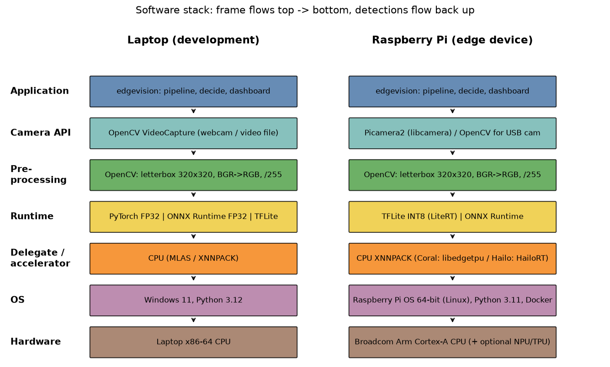

# Edge Inspection — Edge AI & Embedded Vision Systems (individual assessment)

**Karthik Aravind M (S10)** · a complete edge visual-inspection station for my IDRP 3D-printed enclosure:
camera → INT8 detector → pass/fail inspection → decision → relay/LED + PLC + secure MQTT → live dashboard,
with motor-vibration monitoring, OTA updates and fail-safe behaviour. Runs on a Raspberry Pi in Docker and starts by
itself after a power cycle.

Objects (classes): **enclosure** (my closed printed part), **body** = Model 1, **lid** = Model 2 — both models split
from my CAD file `cad/enclosure_full.stl`.



## How it works (one paragraph)
`hal/` hides the hardware (webcam/video ↔ Picamera2, console ↔ GPIO relay, CSV ↔ MPU6050, fake ↔ Modbus), so the same
code runs on the laptop and the Pi (`EDGE_TARGET=laptop|pi`). A YOLOv8n trained on my own labelled frames and CAD
renders, quantised to **TFLite INT8 (3.2 MB)**, finds the part; `inspect.py` checks it against limits learned from
good parts only; a **3-of-5 debounce** turns frames into one decision per part; a `reject` output pulses and the PLC
counts; a `run_permit` relay is on only while the system is healthy, so a lost camera, a crash or a power cut all stop
the line. Everything is published on an internal bus that feeds **MQTT over TLS**, the **dashboard** and the logs.
Details: [docs/ARCHITECTURE.md](docs/ARCHITECTURE.md).

## Results so far (laptop; Pi runs follow [docs/PI_CHECKLIST.md](docs/PI_CHECKLIST.md))

| Milestone | Key measured numbers | Evidence |
|---|---|---|
| **M1 Detect** | real test mAP@0.5 **0.995**, mAP@0.5:0.95 0.995 (real val 0.991 / 0.951); 10 wrong detections analysed; laptop 68.6 FPS | `evidence/M1/`, [TARGETS](docs/TARGETS.md), [DATA_CARD](docs/DATA_CARD.md) |
| **M2 Optimize** | TFLite INT8 **3.2 MB**, mAP@0.5 drop **0.001** vs its FP32; ONNX INT8 3.6 MB, drop 0.024; fair benchmark (20 warm-up, 200 runs) | `evidence/M2/comparison.md`, [OPTIMISATION](docs/OPTIMISATION.md) |
| **M3 Decide & Act** | one bad frame never fires, 3-in-a-row does; safe state **1.06 s** after camera loss; 2 streams × 30 FPS; frame→actuator p95 **8.8 ms** (part→actuator 75 ms) | `evidence/M3/`, [DECISION_RULES](docs/DECISION_RULES.md) |
| **M4 Monitor & Connect** | MQTT security **6/6**; 3 topics, 0 schema failures; PLC 7/7 pulses; OTA v1→v2, broken v3 rolled back, tampered refused; restart after crash **1.2 s**; motor alert 1.0 s (synthetic IMU) | `evidence/M4/`, [MQTT_TOPICS](docs/MQTT_TOPICS.md), [THREAT_MODEL](docs/THREAT_MODEL.md) |
| **M5 Complete system** | 10-min full chain: **30.0 FPS**, 0 errors, 171/172 parts tracked, 1858 MQTT msgs, part→reject p95 90 ms; 20-part stand-in test **16/20, false-pass 0.30 (target 0.10 not met yet — rig test pending)**; readiness 7/7 | `evidence/M5/`, [DEFECTS](docs/DEFECTS.md), [DEMO](docs/DEMO.md) |

Everything measured is in `evidence/` and collected in [docs/RESULTS.md](docs/RESULTS.md) (`python scripts/make_report.py`).
Every evidence json records the host it ran on: laptop numbers are never presented as Pi numbers.

## Quick start — laptop
```bash
py -3.12 -m venv .venv
.venv\Scripts\activate            # Pi/Linux: source .venv/bin/activate
pip install -r requirements.txt
pip install -e .
pytest -q                         # 29 tests
python scripts/station_sim.py --minutes 2        # full station on a simulated conveyor -> http://localhost:8000
python -m edgevision.app --dashboard --inspect   # with the webcam
```
Docker on the laptop: `docker compose -f docker/compose.yaml -f docker/compose.laptop.yaml up -d --build`.

## Quick start — Raspberry Pi
Section 0 of [docs/PI_CHECKLIST.md](docs/PI_CHECKLIST.md) (OS, camera, I²C, Docker), then:
```bash
bash docker/mosquitto/make_certs.sh $(hostname -I | awk '{print $1}') && python docker/mosquitto/make_passwd.py
docker compose -f docker/compose.yaml up -d --build
sudo cp deploy/edge-compose.service /etc/systemd/system/ && sudo systemctl enable edge-compose
```
Dashboard: `http://pi-karthik.local:8000`.

## Repository map
| Path | What |
|---|---|
| `src/edgevision/hal/` | camera, actuator, IMU, PLC interfaces + laptop fakes + Pi implementations |
| `src/edgevision/detect/` | detector interface; PyTorch, ONNX Runtime, TFLite backends |
| `src/edgevision/runtime.py`, `app.py` | the station loop, camera watchdog, entry point |
| `src/edgevision/decide/` | N-of-M debounce, one trigger per part, safe state, part tracking |
| `src/edgevision/inspect.py` | pass/fail checks (mark, chipped corner, lid missing / not seated) |
| `src/edgevision/monitor/` | IMU features, normal-only anomaly model, live alert |
| `src/edgevision/comms/mqtt.py` | MQTT over TLS bridge |
| `src/edgevision/ops/` | OTA (hash → health check → rollback), health check, rotating logs |
| `src/edgevision/dashboard/` | FastAPI REST + WebSocket + MJPEG, static web UI (offline) |
| `scripts/` | data pipeline, training (Colab), export/quantise, evaluate, benchmarks, every evidence script |
| `docker/`, `deploy/` | Dockerfile, compose, Mosquitto TLS config, systemd units, OTA bundles, OpenPLC program |
| `cad/` | my CAD: full enclosure, Model 1 (body), Model 2 (lid) |
| `docs/` | see below |
| `evidence/M1..M5/` | every measured number (json/csv/png/log) |

## Documents
[DATASHEET](docs/DATASHEET.md) · [ARCHITECTURE](docs/ARCHITECTURE.md) · [TARGETS](docs/TARGETS.md) ·
[DATA_CARD](docs/DATA_CARD.md) · [OPTIMISATION](docs/OPTIMISATION.md) · [DECISION_RULES](docs/DECISION_RULES.md) ·
[MQTT_TOPICS](docs/MQTT_TOPICS.md) · [THREAT_MODEL](docs/THREAT_MODEL.md) · [DEFECTS](docs/DEFECTS.md) · [RIG](docs/RIG.md) ·
[DEMO (live demo script + video shot list)](docs/DEMO.md) · [PI_CHECKLIST](docs/PI_CHECKLIST.md) · [VIVA_NOTES](docs/VIVA_NOTES.md) ·
[RESULTS](docs/RESULTS.md)

## Honest limits
- Training data: one 74 s video on one desk + CAD renders; test set is 18 real frames → M1 scores are "same scene".
- Motor model and false alarms are from **synthetic** IMU data until the MPU6050 runs are recorded on the Pi.
- Pass/fail is measured on a laptop stand-in with **simulated** marks/chips; chipped corners are not caught yet.
- All device numbers (Pi FPS, latency, temperature, cold boot, OpenPLC) are pending the Pi.
