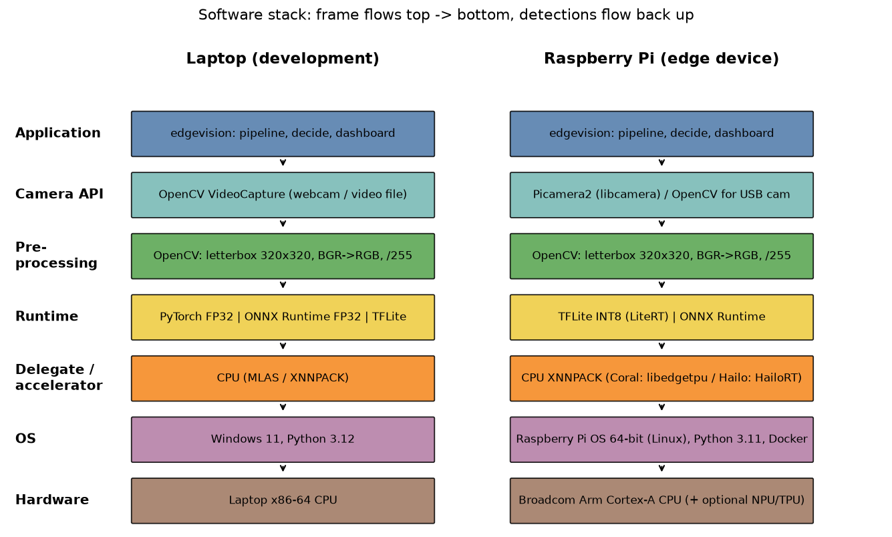
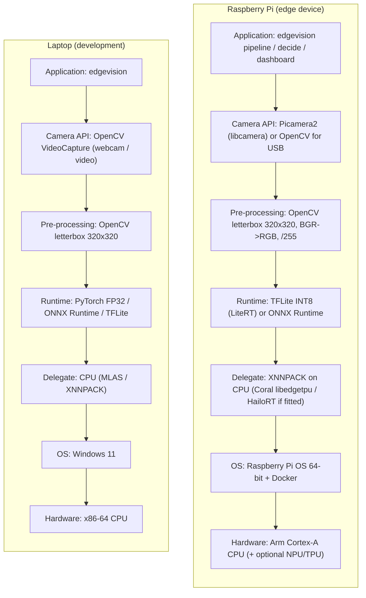
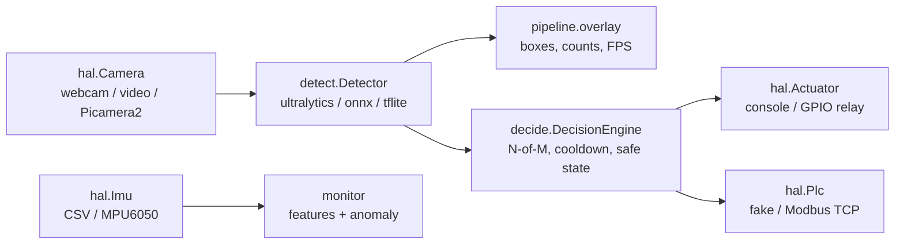

# Architecture

## Software stack (M2.5)

(`docs/stack.png` is drawn by `scripts/draw_stack.py`; the same stack as Mermaid below renders on GitHub.)

## Code structure

Only `hal/*` and the runtime backends import hardware/runtime libraries. Switching laptop -> Pi is `EDGE_TARGET=pi`
(`config/pi.yaml`), not a code change.

## Why the runtime is pluggable
`make_detector()` builds the backend named in the config. The same `detect(image) -> [Detection]` contract is used by
the live pipeline, the evaluator and the benchmark, so accuracy and speed are compared on identical pre/post-processing.
An accelerator is added by passing a delegate (e.g. `delegate: libedgetpu.so.1` for Coral) or a new backend class.
