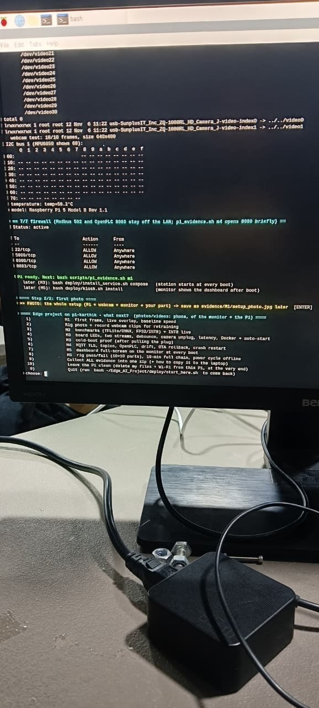
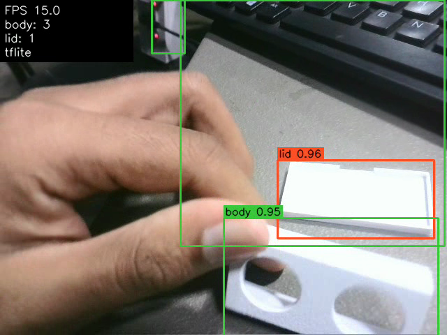
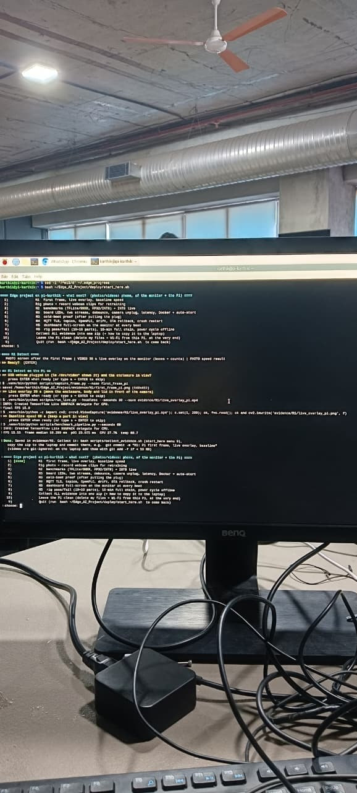
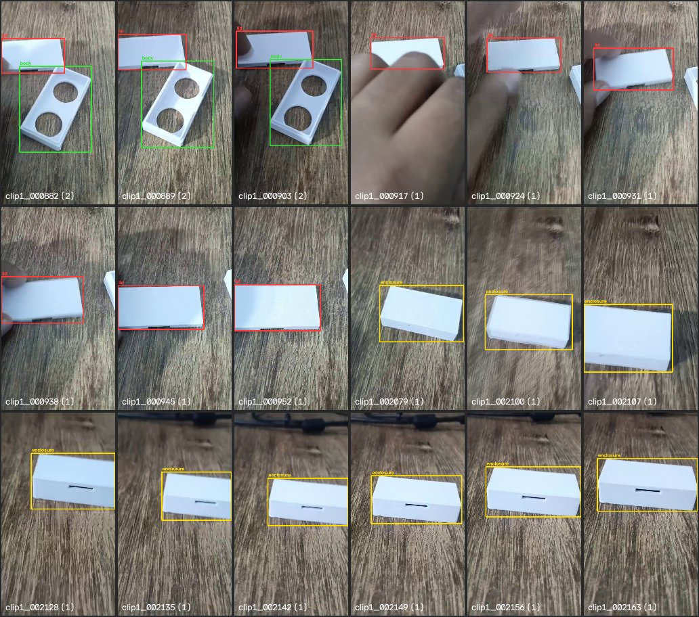
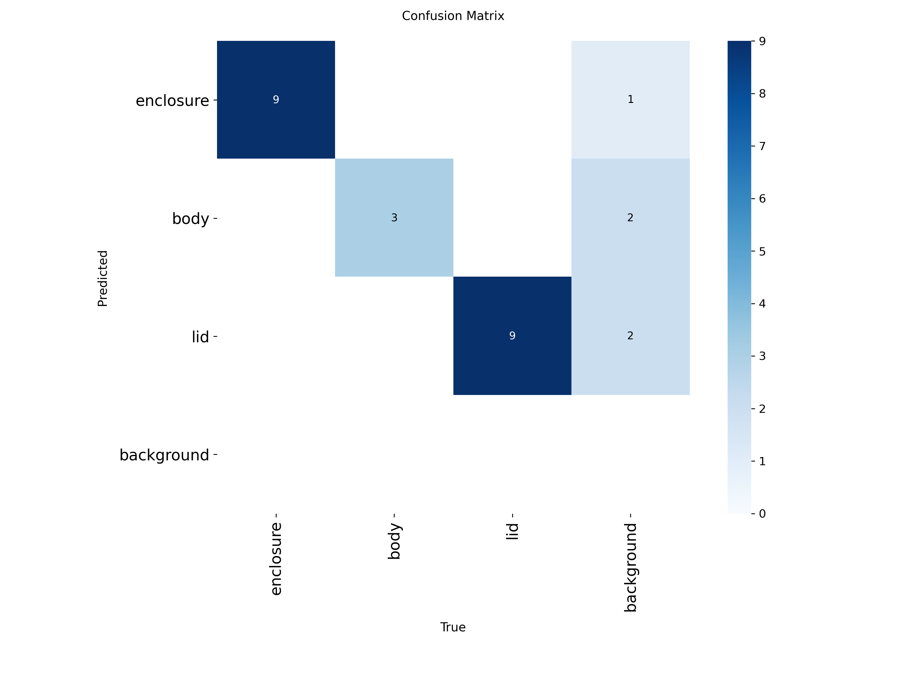
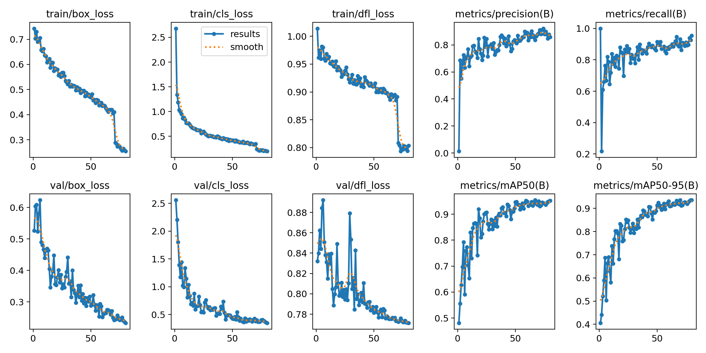
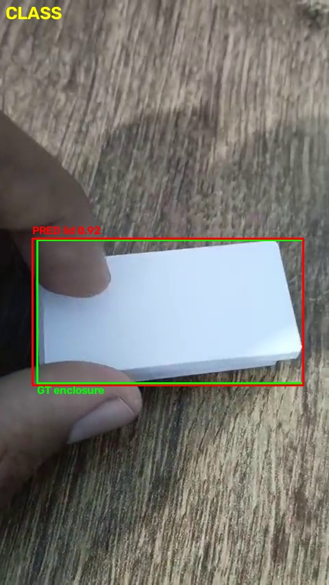
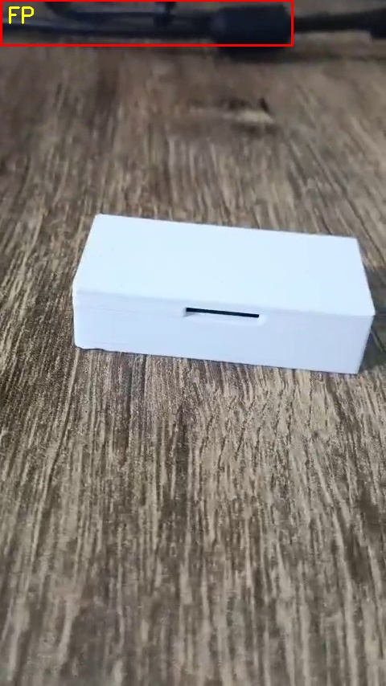

# M1 — Detect: evidence

One section per task on the marking sheet. Each section shows what the task asks for, my measured number, the proof
(shown on this page where it is an image) and the commit that added it. All files sit flat in this folder because the
scripts write them here.

**Device:** Raspberry Pi 5 Model B Rev 1.1, 4 GB, Raspberry Pi OS Bookworm 64-bit, USB webcam 640×480 MJPG, run on
6 Nov 2026 (notes: [PI_RUN.md](PI_RUN.md)). Every json records the host it ran on.

| Task | Max | Measured | Section |
|---|---|---|---|
| Camera and repo | 2 | first 640×480 frame on the Pi, own commit `96d6253` | [1.1](#11-camera-and-repo) |
| OpenCV pipeline | 4 | live boxes + counts on the Pi, 15.6 FPS | [1.2](#12-opencv-pipeline) |
| Baseline speed | 3 | 15.55 FPS, latency 19.3 / 23.1 ms, CPU 27.7 %, 60.7 °C | [1.3](#13-baseline-speed) |
| Dataset v1 | 4 | 217 real frames + 450 CAD renders, 3 classes, data card | [1.4](#14-dataset-v1) |
| Correct split | 2 | 70 / 20 / 10 by time blocks, 0 duplicates across splits | [1.5](#15-correct-split) |
| Train and run detector | 5 | test mAP@0.5 0.995, P 0.979, R 1.000; 10 wrong detections explained | [1.6](#16-train-and-run-detector) |

---

## 1.1 Camera and repo

**Asked:** capture a frame on the device; own commit with the spec sheet and first frame.

- First frame captured on the Pi with the USB webcam through my camera HAL: 640×480 →
  [first_frame_pi.png](first_frame_pi.png), metadata [first_frame_pi.json](first_frame_pi.json)
  (records the host: Raspberry Pi 5 Model B Rev 1.1).
- Spec sheet: [docs/DATASHEET.md](../../docs/DATASHEET.md) (device, CPU, RAM, OS, camera, measured performance).
- Own commits: first frame + Pi results `96d6253` (7 Nov 2026), spec sheet `1778afb` (3 Nov 2026) —
  [commit history](https://github.com/mkarthikaravind1/Edge_AI_Project/commits/main).
- Code: [scripts/capture_frame.py](../../scripts/capture_frame.py), [src/edgevision/hal/camera.py](../../src/edgevision/hal/camera.py).

| First frame on the Pi | Pi monitor: setup check (webcam 10/10 frames, Pi 5 detected) |
|---|---|
|  |  |

## 1.2 OpenCV pipeline

**Asked:** run the live overlay (boxes + count) on the device.

- Live on the Pi for 30 s: each frame → detector → box, class, confidence, per-class count and FPS drawn on the frame.
- Body 0.95 and lid 0.96 detected live; running at ~15.6 FPS (the webcam's frame rate).
- Video: [live_overlay_pi.mp4](live_overlay_pi.mp4) (30 s; GitHub cannot preview it — use *View raw* to download).
- Code: [scripts/run_live.py](../../scripts/run_live.py), drawing in [src/edgevision/pipeline/overlay.py](../../src/edgevision/pipeline/overlay.py).

| Frame from the live run on the Pi | Photo of the Pi monitor during the run |
|---|---|
|  |  |

Honest note: on the new webcam and background it also drew 2 false `body` boxes (hand, keyboard) — the model was
trained on phone video of a wooden desk.

## 1.3 Baseline speed

**Asked:** measure FPS, latency, CPU/GPU load and temperature; show my own numbers.

60 s run on the Pi, 20 warm-up frames not timed, 934 timed frames, TFLite INT8 @ 320 px
([baseline_pi.json](baseline_pi.json), per-second samples [baseline_pi_samples.csv](baseline_pi_samples.csv)):

| Metric | Raspberry Pi 5 |
|---|---|
| FPS | **15.55** (camera-limited; the model alone runs at ~54 FPS, see M2) |
| Frame latency (capture → overlay done) median / p95 | **19.3 ms / 23.1 ms** |
| Inference latency median / p95 | 18.9 ms / 22.6 ms |
| CPU load mean / peak | **27.7 % / 38.1 %** |
| GPU load | not used — inference runs on the CPU (no GPU delegate on the Pi) |
| SoC temperature mean / peak | **60.7 °C / 63.7 °C** |

I report median and p95, not only the mean, because a few slow frames hide inside a mean.
Laptop for comparison: [baseline_laptop.json](baseline_laptop.json) (68.6 FPS). Code: [scripts/benchmark_pipeline.py](../../scripts/benchmark_pipeline.py).

## 1.4 Dataset v1

**Asked:** label images with tight, correct boxes; show my labelled images and the data card.

- Data card: [docs/DATA_CARD.md](../../docs/DATA_CARD.md) — classes, sources, counts, capture conditions, labelling rules, review log, known gaps.
- 3 classes: **enclosure** (closed part), **body** (Model 1), **lid** (Model 2) — from my own prints and my CAD file.
- Real frames: 74 s video → 314 sampled → 72 blurry and 25 near-duplicates dropped → **217 kept**
  ([extract_frames.json](extract_frames.json)); plus 450 CAD renders with exact boxes from the pixel mask.
- Label check: 0 empty, tiny, overlapping or malformed boxes ([label_check.json](label_check.json),
  [label_check_real.json](label_check_real.json)).
- Review log per frame: [data/labelled/reviewed.csv](../../data/labelled/reviewed.csv); labelling rules and
  review passes in the data card.
- Code: [extract_frames.py](../../scripts/extract_frames.py), [render_cad.py](../../scripts/render_cad.py),
  [autolabel.py](../../scripts/autolabel.py), [review_labels.py](../../scripts/review_labels.py), [check_labels.py](../../scripts/check_labels.py).

**My labelled images** — all 18 real test images with their boxes (yellow = enclosure, green = body, red = lid;
count in brackets), drawn from the label files by [scripts/label_sheet.py](../../scripts/label_sheet.py):

## 1.5 Correct split

**Asked:** explain and show the 70/20/10 split with no leakage.

- Neighbouring video frames are near copies, so a random split would leak twins into test. Instead the video is cut
  into **20 time blocks** and whole blocks go to one split; frames within **0.5 s** of a boundary are dropped.
- Then every test image is pHash-checked against every train image: **0 duplicates**.
- Result (real frames): **train 126 / val 36 / test 18 = 70 / 20 / 10 %**; test is real images only;
  CAD renders only in train/val; augmentation (×2) only on train, after the split.
- Evidence: [split_report.json](split_report.json), [augment.json](augment.json),
  [data/splits/data.yaml](../../data/splits/data.yaml), explanation in [DATA_CARD § Split](../../docs/DATA_CARD.md#split).
- Code: [scripts/split.py](../../scripts/split.py), [scripts/augment.py](../../scripts/augment.py).

| Split | Real | CAD renders | Augmented | enclosure | body | lid |
|---|---|---|---|---|---|---|
| train | 126 | 350 | 252 | 244 | 346 | 413 |
| val | 36 | 100 | – | 52 | 81 | 75 |
| test | 18 | 0 | – | 9 | 3 | 9 |

## 1.6 Train and run detector

**Asked:** mAP@0.5, precision, recall, confusion matrix vs the target; explain 10 wrong detections.

YOLOv8n fine-tuned from public COCO weights, 80 epochs, 320 px. Targets were written **before** training
([docs/TARGETS.md](../../docs/TARGETS.md)). Evidence: [train_eval.json](train_eval.json), [eval_val_real.json](eval_val_real.json).

| Metric (real test set, 18 images) | Target | Achieved | Met? |
|---|---|---|---|
| mAP@0.5 | ≥ 0.85 | **0.995** | ✅ |
| mAP@0.5:0.95 | ≥ 0.60 | **0.995** | ✅ |
| Precision | ≥ 0.85 | **0.979** | ✅ |
| Recall | ≥ 0.85 | **1.000** | ✅ |

Real val (36 images): mAP@0.5 0.991, mAP@0.5:0.95 0.951. 320 px chosen over 640 px: same mAP@0.5, ~4× less compute.

| Confusion matrix (test, 320 px) | Training curves |
|---|---|
|  |  |

**10 wrong detections, each explained** — full table with the why and the fix: [wrong_detections/wrong_detections.md](wrong_detections/wrong_detections.md).
- 5 / 10 (#2–#5, #10) are slivers of a part cut off at the image edge (my labelling rule skips those) → ignore boxes touching the border.
- 2 / 10 (#1, #6) are a black cable seen as `body` → add cluttered backgrounds as hard negatives.
- 3 / 10 (#7–#9) are a closed box seen from straight above: called `lid`, once with a second box → camera at 30–45° on the rig, class-agnostic NMS.
- 0 missed parts.

| #7: closed box from above called `lid` | #1: cable called `body` |
|---|---|
|  |  |

Running the trained detector on the device: see [1.2](#12-opencv-pipeline).
Code: [scripts/train_colab.ipynb](../../scripts/train_colab.ipynb), [evaluate.py](../../scripts/evaluate.py), [wrong_detections.py](../../scripts/wrong_detections.py).

**Honest limits:** one video, one desk, one light → the score means "same scene"; 18 test images (3 body boxes),
so one extra mistake moves precision by ~5 points.

---
More: [VIVA_NOTES § M1](../../docs/VIVA_NOTES.md#m1-detect) · all numbers: [RESULTS § M1](../../docs/RESULTS.md#m1)
