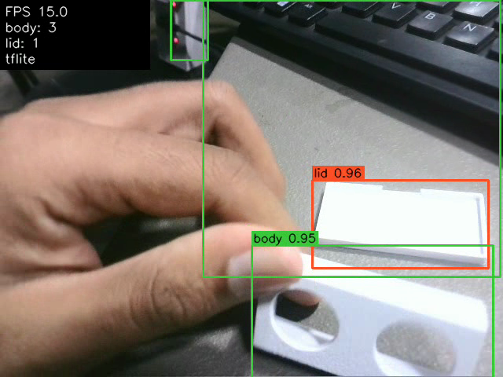
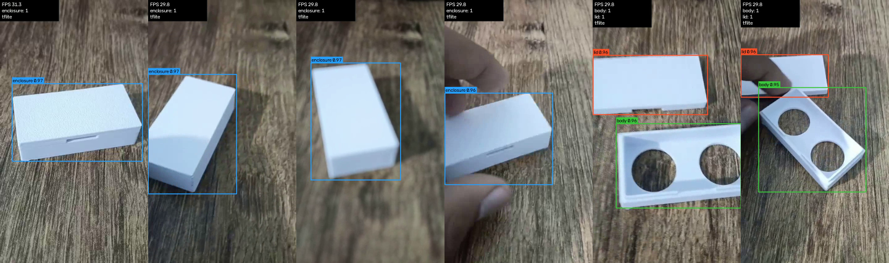
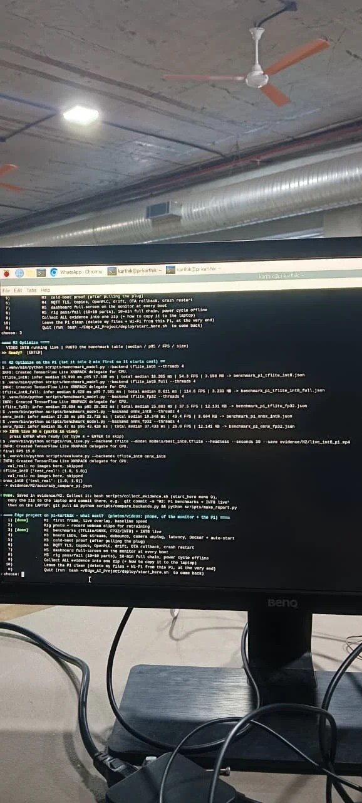
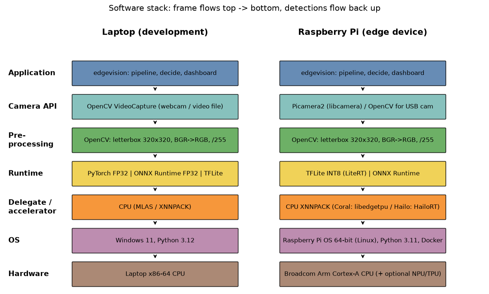

# M2 — Optimize: evidence

One section per task on the marking sheet. Each section shows what the task asks for, my measured number, the proof
and the commit that added it. All files sit flat in this folder because the scripts write them here.

**Device:** Raspberry Pi 5 Model B Rev 1.1, 4 GB, Bookworm 64-bit, Python 3.11.2, **CPU only (no accelerator fitted)**,
run on 6 Nov 2026 (notes: [PI_RUN.md](PI_RUN.md)). Full laptop-vs-Pi table: [comparison.md](comparison.md).

| Task | Max | Measured | Section |
|---|---|---|---|
| Export to ONNX | 3 | `best.pt` 6.2 MB → ONNX 12.1 MB, opset 13; own commit `35490f5` | [2.1](#21-export-to-onnx) |
| Convert and run live | 4 | TFLite INT8 3.2 MB, live on the Pi at 15.6 FPS | [2.2](#22-convert-and-run-live) |
| Accuracy check | 4 | mAP@0.5 drop FP32 → INT8: 0.0007 (TFLite), test set 1.000 → 1.000 | [2.3](#23-accuracy-check) |
| Fair benchmark | 4 | Pi INT8 median 16.0 ms, p95 17.2 ms, 54.3 FPS, 3.2 MB | [2.4](#24-fair-benchmark) |
| CPU vs accelerator + stack | 2 | CPU FP32 vs CPU INT8: 1.5–2× faster, 3.8× smaller; stack drawn | [2.5](#25-cpu-vs-accelerator--stack) |
| Own target and trade-off | 3 | all 4 targets (written before training) met on the Pi 5 | [2.6](#26-own-target-and-trade-off) |

---

## 2.1 Export to ONNX

**Asked:** run the ONNX export myself and show my commit.

- `python scripts/export.py --format onnx` → [models/best.onnx](../../models/best.onnx): FP32, **12.1 MB**, opset 13,
  fixed batch 1, 320×320 input, export took 2.1 s ([export.json](export.json)).
- ONNX is a standard network file format: any runtime (ONNX Runtime, TensorRT, …) runs it without PyTorch.
  Opset 13 is needed for per-channel INT8 later.
- Own commit: `35490f5` (4 Nov 2026) added `models/best.onnx` and `export.json` —
  [commit history](https://github.com/mkarthikaravind1/Edge_AI_Project/commits/main).
- Code: [scripts/export.py](../../scripts/export.py).

| File | Format | Size |
|---|---|---|
| `best.pt` (source) | PyTorch FP32 | 6.2 MB |
| `best.onnx` | ONNX FP32, opset 13 | 12.1 MB |
| `best_int8.onnx` | ONNX INT8 (QDQ, per-channel weights) | 3.6 MB |

## 2.2 Convert and run live

**Asked:** convert to TFLite INT8 (or TensorRT) and run it live on the device.

- Converted to **TFLite INT8 → [models/best_int8.tflite](../../models/best_int8.tflite), 3.2 MB** (commit `728568f`).
  Calibration: 200 images from the **train** split only, so the model is never tuned on images I score it on.
- Ran it **live on the Pi** with the USB webcam for 30 s: final **15.6 FPS** (camera-limited) —
  video [live_int8_pi.mp4](live_int8_pi.mp4) (GitHub cannot preview it — use *View raw* to download).
- This INT8 model is also what the M1 live overlay and baseline on the Pi used
  ([M1 § 1.2](../M1/README.md#12-opencv-pipeline), [baseline_pi.json](../M1/baseline_pi.json)).
- Code: [scripts/export_colab.ipynb](../../scripts/export_colab.ipynb), [quantize_onnx.py](../../scripts/quantize_onnx.py),
  [run_live.py](../../scripts/run_live.py), runtime in [src/edgevision/detect/backends.py](../../src/edgevision/detect/backends.py).

| INT8 model live on the Pi (frame from the M1 live run) | INT8 model live (laptop screenshot) |
|---|---|
|  |  |

## 2.3 Accuracy check

**Asked:** show mAP before vs after on the same test set.

Same images, same metric code for every model ([scripts/evaluate.py](../../scripts/evaluate.py)), run on the
**Pi's own runtimes** ([accuracy_compare_pi.json](accuracy_compare_pi.json), [comparison.md](comparison.md)):

| Model | Size | mAP@0.5 test | mAP@0.5:0.95 test | mAP@0.5 val | mAP@0.5:0.95 val |
|---|---|---|---|---|---|
| TFLite FP32 (before) | 12.1 MB | 1.000 | 1.000 | 0.9746 | 0.9336 |
| **TFLite INT8 (after, shipped)** | **3.2 MB** | **1.000** | **1.000** | **0.9739** | **0.9288** |
| ONNX FP32 (before) | 12.1 MB | 1.000 | 1.000 | 0.9746 | 0.9336 |
| ONNX INT8 (after) | 3.6 MB | 1.000 | 1.000 | 0.9502 | 0.8860 |

- On the 18 real test images every model scores 1.000, so the test set cannot show a difference; the drop is
  therefore also measured on the 36 real **val** images.
- mAP@0.5 drop FP32 → INT8: **TFLite 0.0007**, ONNX 0.0244 — both inside my target ≤ 0.03.
- Laptop run of the same check: [accuracy_compare.json](accuracy_compare.json).

## 2.4 Fair benchmark

**Asked:** 20 warm-up and 100+ timed runs at batch 1; median and p95 latency, FPS and model size.

On the Pi: batch 1, 4 threads, 320 px, same real images, **20 warm-up + 200 timed runs** per model
([scripts/benchmark_model.py](../../scripts/benchmark_model.py)):

| Model | Size | Inference median | Inference p95 | Total median | FPS | Evidence |
|---|---|---|---|---|---|---|
| **TFLite INT8 (shipped)** | **3.20 MB** | **16.00 ms** | **17.19 ms** | 18.20 ms | **54.3** | [json](benchmark_pi_tflite_int8.json) |
| TFLite full-INT8 | 3.23 MB | 6.63 ms | 7.58 ms | 8.61 ms | 114.6 | [json](benchmark_pi_tflite_int8_full.json) |
| TFLite FP32 | 12.13 MB | 23.68 ms | 28.38 ms | 25.88 ms | 37.5 | [json](benchmark_pi_tflite_fp32.json) |
| ONNX Runtime INT8 | 3.60 MB | 17.38 ms | 22.71 ms | 19.35 ms | 49.4 | [json](benchmark_pi_onnx_int8.json) |
| ONNX Runtime FP32 | 12.14 MB | 35.47 ms | 43.43 ms | 37.43 ms | 26.0 | [json](benchmark_pi_onnx_fp32.json) |

Why this is fair: same images, batch 1, same thread count, warm-up runs thrown away (caches, memory allocation).
Median = typical frame, p95 = bad-but-normal frame; "total" includes pre-processing and NMS, which the live pipeline pays.
Honest note: no cooler fitted, the Pi warmed up to 81.8 °C on the last (ONNX FP32) run, below the 85 °C throttle point.

## 2.5 CPU vs accelerator + stack

**Asked:** show the CPU vs accelerator table and draw the software stack.

No accelerator (Coral / Hailo / GPU delegate) is fitted on my Pi, so the comparison is **CPU FP32 vs CPU INT8** on the Pi:

| Runtime | CPU FP32 | CPU INT8 | Speed-up | Size |
|---|---|---|---|---|
| TFLite (XNNPACK) | 23.68 ms | **16.00 ms** | **1.5×** | 12.1 → 3.2 MB (3.8× smaller) |
| ONNX Runtime | 35.47 ms | **17.38 ms** | **2.0×** | 12.1 → 3.6 MB (3.4× smaller) |
| Laptop CPU (Intel Core Ultra 5 225H), TFLite | 12.65 ms | 8.98 ms | 1.4× | same files |

The detector is a plug-in: adding a Coral is a config change plus an Edge-TPU-compiled model (the full-INT8 TFLite
is kept ready for it, because the Edge TPU needs int8 input/output).

**Software stack** (camera → OpenCV → runtime → delegate → OS → hardware) — [docs/stack.png](../../docs/stack.png),
drawn by [scripts/draw_stack.py](../../scripts/draw_stack.py):

## 2.6 Own target and trade-off

**Asked:** the accuracy and speed target I wrote before training, my result, and the trade-off in simple words.

Targets written **3 Nov 2026, before training**: [docs/TARGETS.md](../../docs/TARGETS.md) (machine-readable [targets.json](../../docs/targets.json)).

| Target (written before training) | Result on the Pi 5 | Met? |
|---|---|---|
| INT8 mAP@0.5 drop ≤ 0.03 | 0.0007 (TFLite INT8) | ✅ |
| INT8 model ≤ 4 MB | 3.20 MB | ✅ |
| Pi 5 inference median ≤ 60 ms | 16.0 ms | ✅ |
| Live FPS ≥ 12 on the Pi 5 | 15.5 (camera-limited) | ✅ |

**Trade-off in simple words:** INT8 stores the weights as 8-bit numbers instead of 32-bit, so the file is about 4×
smaller and the Pi's CPU does the maths faster, while the boxes stay just as good on my images. The price is a
calibration step and a small accuracy risk on unusual images — the accuracy check above measures it. Where you round
matters: rounding the output too (full-INT8) makes boxes less tight (val mAP@0.5:0.95 0.934 → 0.877), so I ship the
TFLite INT8 model with float output. Details: [docs/OPTIMISATION.md](../../docs/OPTIMISATION.md).

---
More: [VIVA_NOTES § M2](../../docs/VIVA_NOTES.md#m2-optimize) · all numbers: [RESULTS § M2](../../docs/RESULTS.md#m2)
