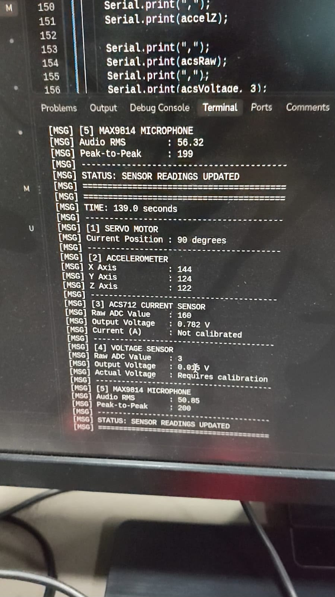
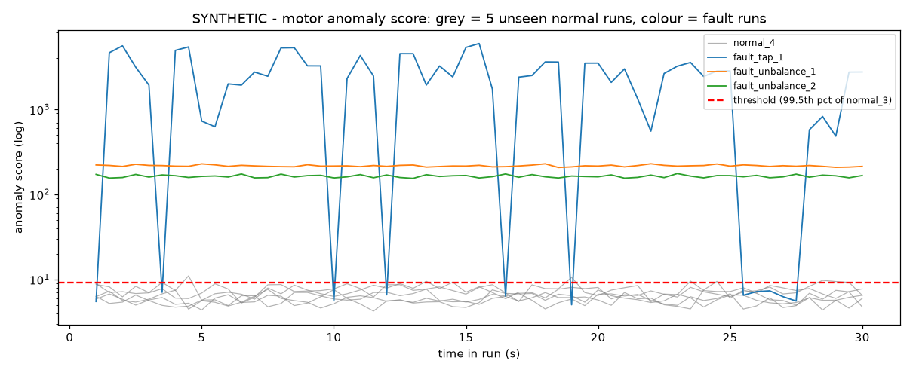
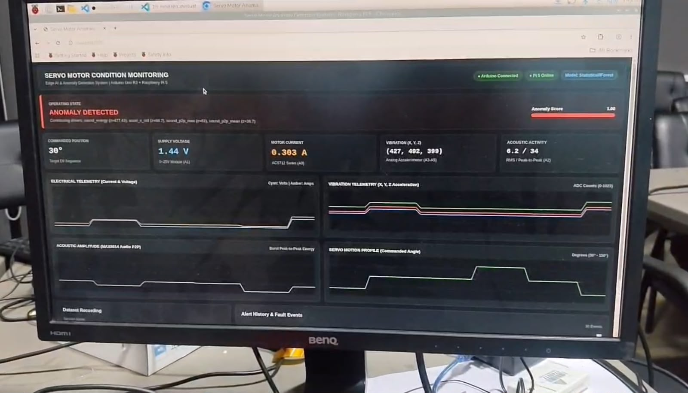
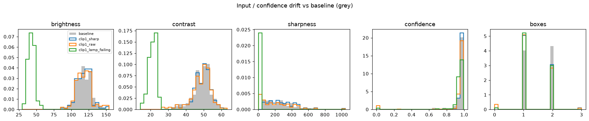

# M4 — Monitor and Connect: evidence

One section per task on the marking sheet. Each section shows what the task asks for, what I measured so far, the
files, and a place for the **group run on the Pi** (photos in this folder, videos as Drive/YouTube links).

**Where it ran:** 💻 = measured on my laptop (every json records its host) · 👥 Pi = group run on the shared Pi rig.
⚠️ The motor results (4.1–4.3) so far use clearly labelled **synthetic** IMU data; real MPU6050 runs
replace them. Pi commands: [PI_CHECKLIST § M4](../../docs/PI_CHECKLIST.md#m4--monitor-and-connect-on-the-pi).

**Group media rule:** every photo/video from the group session is labelled *"group run on the shared Pi rig — my part:
… — filmed by …"*. My own measured numbers are listed separately from the group media.

### Group rig (shared Raspberry Pi 5)

The group's M4 system on the shared rig is an **SG90 servo condition monitor**: an Arduino Uno reads an MPU6050
(vibration), ACS712 (current), a 0–25 V divider (voltage) and a MAX9814 microphone (sound) at 10 Hz and sends CSV rows
over USB serial to the Pi 5. The Pi runs a 21-feature anomaly model and a web dashboard. My own motor monitor (6-axis
MPU6050 at 200 Hz, 36 features) is a separate system. Group media below shows that rig, not my numbers. All group
files are in [group/](group/), one folder per task.

Group media caption: *group run on the shared Pi rig — my part: filming the group run — filmed by me* (all files in
[group/](group/)).

**All group M4 photos and videos (Google Drive):** [M4 Photos & Videos Evidence Folder](https://drive.google.com/drive/folders/1Rb_cH2TGkXbIfMN6ufUxH2sYoraduzOa?usp=sharing).
The photos and videos from the group's repo are also in [group/](group/) here.

**Group reports and logs:** the group's TLS, MQTT, Modbus and reliability logs and reports, its benchmark and
false-alarm reports, and its charts are the values my group member measured on the rig. They were then written into
files by the group's script [generate_m4_evidence.py](group/scripts/generate_m4_evidence.py), so they are a write-up of
the results, not raw captures. Each is marked 📝 *group-reported* below. Where a chart's shape comes from that script
rather than from recorded scores, it says so.

| Task | Max | Measured so far | Section |
|---|---|---|---|
| Sensor data | 3 | 8 normal + 3 fault runs, 6 axes at 200 Hz (synthetic) | [4.1](#41-sensor-data) |
| Anomaly model | 4 | trained on normal only; live alert 1.0 s after the fault | [4.2](#42-anomaly-model) |
| False alarms | 2 | 1 false alarm in 5 unseen normal runs; threshold = 99.5th percentile | [4.3](#43-false-alarms) |
| Secure MQTT | 3 | 6/6 security cases (no-password refused, password + TLS works) | [4.4](#44-secure-mqtt) |
| Topics | 2 | detection, motor score, status received; 0 schema failures | [4.5](#45-topics) |
| PLC link | 2 | 7 triggers → 7 coil pulses, register 1 → 7 | [4.6](#46-plc-link) |
| Threat model | 1 | 1 threat per level (4 levels), 5 mitigations applied | [4.7](#47-threat-model) |
| Reliability | 3 | drift report; OTA v1 → v2, broken v3 rolled back; restart after crash 1.2 s | [4.8](#48-reliability) |

---

## 4.1 Sensor data

**Asked:** wire/read the MPU6050 and show labelled normal and fault CSV runs (3 each).

- MPU6050 on I²C-1 (address 0x68): 3-axis accelerometer + 3-axis gyro at **200 Hz**, 30 s per run, saved as labelled CSVs.
  Wiring table: [PI_CHECKLIST § 4.1](../../docs/PI_CHECKLIST.md#41-mpu6050-wiring-pi-off-while-wiring).
- ⚠️ Runs so far (synthetic, labelled as such — [data/imu/synthetic/README.md](../../data/imu/synthetic/README.md)):
  **8 normal** (`normal_1` … `normal_8`) and **3 fault** runs: [fault_unbalance_1](../../data/imu/synthetic/fault_unbalance_1.csv),
  [fault_unbalance_2](../../data/imu/synthetic/fault_unbalance_2.csv), [fault_tap_1](../../data/imu/synthetic/fault_tap_1.csv).
- Code: [scripts/record_imu.py](../../scripts/record_imu.py) (real sensor), [scripts/gen_synthetic_imu.py](../../scripts/gen_synthetic_imu.py),
  [src/edgevision/hal/imu.py](../../src/edgevision/hal/imu.py).

👥 **Group run on the Pi** (group's servo monitor, Arduino Uno → Pi 5 over USB serial):
- Videos: [hardware set-up walkthrough](group/01_sensor_data/videos/initial_hardware_configuration.mp4),
  [servo mounting and wiring](group/01_sensor_data/videos/initial_configuration_servo_motor.mp4),
  [servo moving with sensor values](group/01_sensor_data/videos/servo_motion_and_sensorvalues_demonstration.mp4),
  [values in the serial monitor](group/01_sensor_data/videos/sensor_values_showing_in_serial_monitor.mp4),
  [long serial-monitor stream during servo motion](group/01_sensor_data/videos/serial_monitor_servo_sensor_stream.mp4),
  [values updating](group/01_sensor_data/videos/values_showing.mp4).
- Photos: group member at the rig ([1](group/01_sensor_data/screenshots/me_working_photo.jpeg),
  [2](group/01_sensor_data/screenshots/me_working_photo2.jpeg)); terminal printing servo angle, accelerometer X/Y/Z,
  ACS712, voltage and microphone readings ([1](group/01_sensor_data/screenshots/sensor_values_shown_in_terminal.jpeg),
  [2](group/01_sensor_data/screenshots/sensor_values_shown_in_terminall.jpeg)).
- Frames from the videos: [set-up](group/01_sensor_data/screenshots/initial_hardware_configuration_frame.png),
  [servo wiring](group/01_sensor_data/screenshots/servo_motor_mounting_and_wiring_frame.png),
  [serial monitor](group/01_sensor_data/screenshots/serial_monitor_streaming_frame.png),
  [serial stream](group/01_sensor_data/screenshots/serial_monitor_servo_sensor_stream_frame.png),
  [live values](group/01_sensor_data/screenshots/telemetry_values_live_stream_frame.png),
  [servo motion](group/01_sensor_data/screenshots/servo_motion_and_sensorvalues_frame.png).
- Recorded sensor rows (10 fields: time, sequence, angle, voltage, current, accel X/Y/Z, sound RMS, sound peak-to-peak):
  [baseline_telemetry_sample.csv](group/01_sensor_data/datasets/baseline_telemetry_sample.csv),
  [serial_telemetry_raw_capture.log](group/01_sensor_data/logs/serial_telemetry_raw_capture.log), plotted in
  [sensor_waveforms_plot.png](group/01_sensor_data/screenshots/sensor_waveforms_plot.png).

## 4.2 Anomaly model

**Asked:** train on normal data only and show the live alert when I inject the fault.

- Each 1 s window (step 0.5 s) → **36 features** = 6 axes × (RMS, peak, FFT energy in 0–5 / 5–20 / 20–50 / 50–100 Hz).
- Trained on **normal runs only** (`normal_1`, `normal_2`, 118 windows): learn each feature's mean and spread;
  score = distance from normal in standard deviations. Alert after 2 windows in a row above the threshold.
- Fault runs: **3/3 detected** (first alert 1.5–2.0 s into the run) — [anomaly_model.json](anomaly_model.json),
  scores plot [anomaly_scores.png](anomaly_scores.png).
- ⚠️ Live alert (synthetic replay at real time): fault injected at 10.0 s → **alert at 11.0 s (1.0 s)**, 0 alerts before
  ([live_alert.json](live_alert.json)). Model file: [models/anomaly.json](../../models/anomaly.json).
- Code: [scripts/train_anomaly.py](../../scripts/train_anomaly.py), [scripts/motor_monitor.py](../../scripts/motor_monitor.py),
  [src/edgevision/monitor/](../../src/edgevision/monitor/anomaly.py).

👥 **Group run on the Pi** (group's servo monitor):
- [video_showing_anomaly.mp4](group/02_anomaly_model/videos/video_showing_anomaly.mp4): a mechanical fault is
  injected on the servo and the group's model flags it live. Frames: [before](group/02_anomaly_model/screenshots/anomaly_baseline_frame.png),
  [fault injected](group/02_anomaly_model/screenshots/anomaly_triggered_frame.png),
  [detection](group/02_anomaly_model/screenshots/anomaly_detection_event_frame.png).
- [dashboard_anomaly_detected.jpeg](group/02_anomaly_model/screenshots/dashboard_anomaly_detected.jpeg): the Pi 5
  dashboard shows **ANOMALY DETECTED** with anomaly score 1.00 (read off the screen, not a measurement of mine).
- Group model settings: [model_summary.json](group/02_anomaly_model/model_results/model_summary.json) (21 features,
  10-sample window at 10 Hz, threshold 0.65).
- 📝 *group-reported* benchmark on the Pi 5 ([model_benchmark_report.txt](group/02_anomaly_model/test_results/model_benchmark_report.txt)):
  feature extraction 0.082 ms, inference 0.109 ms, total 0.191 ms per window, 14.2 MB RAM.
- 📝 *group-reported* charts: [anomaly_score_trajectory.png](group/02_anomaly_model/charts/anomaly_score_trajectory.png)
  (score low while normal, high after the fault) and [feature_correlation_heatmap.png](group/02_anomaly_model/charts/feature_correlation_heatmap.png)
  (21 features). Their exact curves and cells are drawn by the script, not plotted from recorded scores.

## 4.3 False alarms

**Asked:** count false alarms over 5 normal runs and explain my threshold.

- Threshold = **99.5th percentile** of scores on `normal_3`, a normal run used **neither for training nor for testing**
  (a training percentile would be too low, because the model always looks best on its own training data) → **9.198**.
- ⚠️ Counted on 5 more unseen normal runs (`normal_4` … `normal_8`, 2.5 min): **1 false alarm** (in `normal_7`), target ≤ 1 ✅
  ([false_alarms.json](false_alarms.json)).
- Trade-off: a higher percentile gives fewer false alarms but later or missed faults.

👥 **Group run on the Pi** — normal vs fault on the group rig: frames
[normal running](group/02_anomaly_model/screenshots/anomaly_baseline_frame.png) and
[fault injected](group/02_anomaly_model/screenshots/anomaly_triggered_frame.png) from
[the anomaly video](group/02_anomaly_model/videos/video_showing_anomaly.mp4) (see [4.2](#42-anomaly-model)).

📝 *group-reported* false-alarm count ([false_alarm_rate_report.txt](group/03_false_alarms/test_results/false_alarm_rate_report.txt)),
200 trials: 150 normal cycles → **0 false alarms**, 50 faults (bind / stall / overcurrent) → 50 detected, so false
alarm rate **0 %**. Threshold reasoning: normal motion gave current pulses of about 0.065–0.146 A and huge scores
because the static training data barely varied, so the group set a minimum spread per feature and a 0.200 A current
limit (binding draws > 0.220 A). Charts: [confusion_matrix_heatmap.png](group/03_false_alarms/charts/confusion_matrix_heatmap.png)
(the counts above) and [anomaly_score_distribution.png](group/03_false_alarms/charts/anomaly_score_distribution.png)
(the histogram shape is drawn by the script, not plotted from recorded scores).

## 4.4 Secure MQTT

**Asked:** show the broker refuses no-password and works with password + TLS.

💻 Mosquitto in Docker, TLS-only listener on 8883 (no plain 1883 at all), no anonymous users, password file, per-user ACL
([mqtt_security.json](mqtt_security.json), log [mqtt_security.log](mqtt_security.log), broker log [mosquitto_broker.log](mosquitto_broker.log)) — **6/6 pass**:

| Case | Expected | Result |
|---|---|---|
| anonymous client over TLS | refused | refused |
| wrong password over TLS | refused | refused |
| correct password but plain TCP :1883 (no TLS) | refused | refused |
| TLS but trusting a different CA (impostor broker) | refused | refused |
| correct password + TLS (publish/subscribe round trip) | accepted | accepted |
| read-only user publishes (ACL) | refused | refused |

Config: [mosquitto.conf](../../docker/mosquitto/mosquitto.conf), [acl](../../docker/mosquitto/acl),
[make_certs.sh](../../docker/mosquitto/make_certs.sh). Test: [scripts/mqtt_security_test.py](../../scripts/mqtt_security_test.py).

👥 **Group rig:** the group's broker config
[mosquitto_secure.conf](group/04_secure_mqtt/configuration_evidence/mosquitto_secure.conf) and certificate script
[generate_x509_certificates.sh](group/04_secure_mqtt/configuration_evidence/generate_x509_certificates.sh).
📝 *group-reported*: TLS 1.2 connection on port 8883 with the broker certificate checked and username/password
accepted ([tls_connection_handshake.log](group/04_secure_mqtt/logs/tls_connection_handshake.log)), and the security
checklist (TLS only, no secrets in git, reconnect backoff) in [mqtt_security_test_log.txt](group/04_secure_mqtt/test_results/mqtt_security_test_log.txt).

## 4.5 Topics

**Asked:** publish detection and motor score and show them on a subscriber.

💻 Subscriber for 120 s ([mqtt_topics_sample.json](mqtt_topics_sample.json)), **0 schema failures**:

| Topic | QoS | Received | Meaning |
|---|---|---|---|
| `edge/<device>/detection` | 1 | 2 | one message per part (class, confidence, box, verdict, latency) |
| `edge/<device>/motor/score` | 0 | 50 | anomaly score, 2 per second |
| `edge/<device>/status` | 1, retained + last will "offline" | 28 | health, FPS, outputs |

Topic design: [docs/MQTT_TOPICS.md](../../docs/MQTT_TOPICS.md). Code: [src/edgevision/comms/mqtt.py](../../src/edgevision/comms/mqtt.py),
subscriber [scripts/mqtt_subscribe.py](../../scripts/mqtt_subscribe.py).

👥 **Group rig:** the group's `motor/servo01/...` topics with payload schemas, QoS and retain flags,
[topic_schema_specification.json](group/05_mqtt_topics/topic_structure/topic_schema_specification.json),
drawn in [topic_hierarchy_tree.png](group/05_mqtt_topics/screenshots/topic_hierarchy_tree.png).
📝 *group-reported*: one message on each of the 6 topics (IMU, current, voltage, audio, status, health) published by
the Pi node over MQTTS port 8883 ([mqtt_publish_subscribe_stream.log](group/05_mqtt_topics/logs/mqtt_publish_subscribe_stream.log)).

## 4.6 PLC link

**Asked:** show the PLC tag change when an object is detected.

- Modbus TCP: on each trigger coil 0 (**%QX0.0**) pulses 0.5 s and holding register 0 (**%QW0**) = part count.
- 💻 Laptop with a Modbus simulator, 70 s: **7 triggers → 7 coil pulses, register 1 → 7**
  ([plc_link_laptop.json](plc_link_laptop.json), timeline [plc_link_laptop.csv](plc_link_laptop.csv)).
- OpenPLC program for the Pi: [deploy/openplc/edge_tags.st](../../deploy/openplc/edge_tags.st).
  Code: [scripts/plc_watch.py](../../scripts/plc_watch.py), [src/edgevision/hal/plc.py](../../src/edgevision/hal/plc.py).

👥 **Group rig:** the group's Modbus TCP register map (input registers for the sensor values, holding register for the
servo command, coil for E-stop), [modbus_register_map_table.png](group/06_plc_link/screenshots/modbus_register_map_table.png).
📝 *group-reported*: read of the 10 sensor registers, servo angle written to 120°, E-stop coil set
([modbus_tcp_transaction.log](group/06_plc_link/communication_logs/modbus_tcp_transaction.log)). As its own summary
says, this was a **software Modbus client, not a physical PLC**, round trip < 1.5 ms
([plc_validation_summary.txt](group/06_plc_link/test_results/plc_validation_summary.txt)).

## 4.7 Threat model

**Asked:** show one threat per level and 2 mitigations applied.

Full table: [docs/THREAT_MODEL.md](../../docs/THREAT_MODEL.md).

| Level | Threat | Mitigation applied | Proof |
|---|---|---|---|
| Device | stolen SD card / shell access reads the broker password | secrets only in git-ignored `.env`, broker keeps salted hashes | `.gitignore` |
| Network | sniffing or spoofing MQTT | TLS only, no anonymous, passwords, ACL, broker certificate check | [4.4](#44-secure-mqtt) 6/6 |
| Application | malicious or broken model update | hash check, health check, automatic rollback | [4.8](#48-reliability) |
| Physical / data | camera covered or unplugged, failing lamp | safe state stops the line; drift report | [M3 § 3.4](../M3/README.md#34-actuator-fires), [4.8](#48-reliability) |

**5 mitigations applied** (≥ 2 required); known gaps (Modbus has no password, dashboard has no login) are listed with their next step.

👥 **Group rig's threat model** (servo monitor): STRIDE table [stride_threat_matrix.md](group/07_threat_model/threat_analysis/stride_threat_matrix.md),
DREAD risk scores [dread_risk_scoring.csv](group/07_threat_model/threat_analysis/dread_risk_scoring.csv), drawn in
[threat_model_stride_matrix.png](group/07_threat_model/screenshots/threat_model_stride_matrix.png).

## 4.8 Reliability

**Asked:** show the drift report, OTA v1 to v2 with rollback, and auto-restart after a forced crash.

- **Drift report** (PSI on brightness, contrast, sharpness, confidence, boxes vs the dataset baseline;
  [drift_report.json](drift_report.json)): sharp frames → all **stable**; hand-shake blur → sharpness **watch**;
  simulated failing lamp → **DRIFT** on 4 of 5.
- **OTA** ([ota.json](ota.json)): install v1 ✅ → upgrade to **v2** ✅ → broken **v3 rolled back to v2** ✅ →
  tampered v2 bundle **refused** (hash mismatch) ✅. Bundles: [deploy/ota/bundles/](../../deploy/ota/bundles/).
- **Auto-restart** ([crash_restart_laptop.log](crash_restart_laptop.log)): forced crash inside the container
  (exit code 70) → Docker restarted it, station back **1.2 s** later (restart count 0 → 1).
- Code: [scripts/drift_report.py](../../scripts/drift_report.py), [scripts/ota.py](../../scripts/ota.py),
  [src/edgevision/ops/ota.py](../../src/edgevision/ops/ota.py).

👥 **Group rig:** the group's serial-reconnect test [recovery_harness.py](group/08_reliability/recovery_tests/recovery_harness.py).
📝 *group-reported* ([reliability_test_report.txt](group/08_reliability/test_results/reliability_test_report.txt)):
- Arduino USB unplugged → found again and stream resumed in **4.98 s**, no crash
  ([serial_reconnect_recovery.log](group/08_reliability/logs/serial_reconnect_recovery.log)).
- 500-frame soak test: 491 inferences, 5,225 frames/s, 0 exceptions.
- Service running under systemd on the Pi 5: [service_status_systemd.png](group/08_reliability/screenshots/service_status_systemd.png)
  (the status text drawn as an image by the script, not a screen capture).

---
More: [VIVA_NOTES § M4](../../docs/VIVA_NOTES.md#m4-monitor-and-connect) · all numbers: [RESULTS § M4](../../docs/RESULTS.md#m4)
