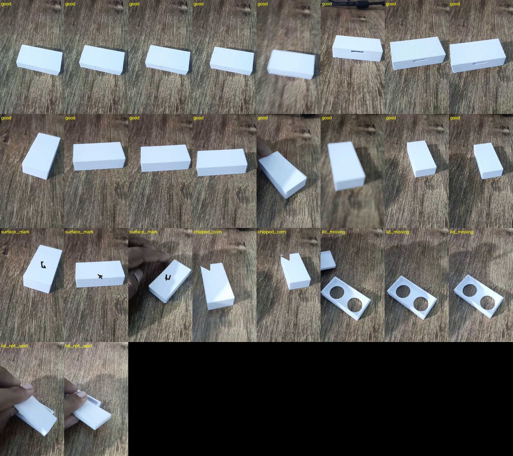
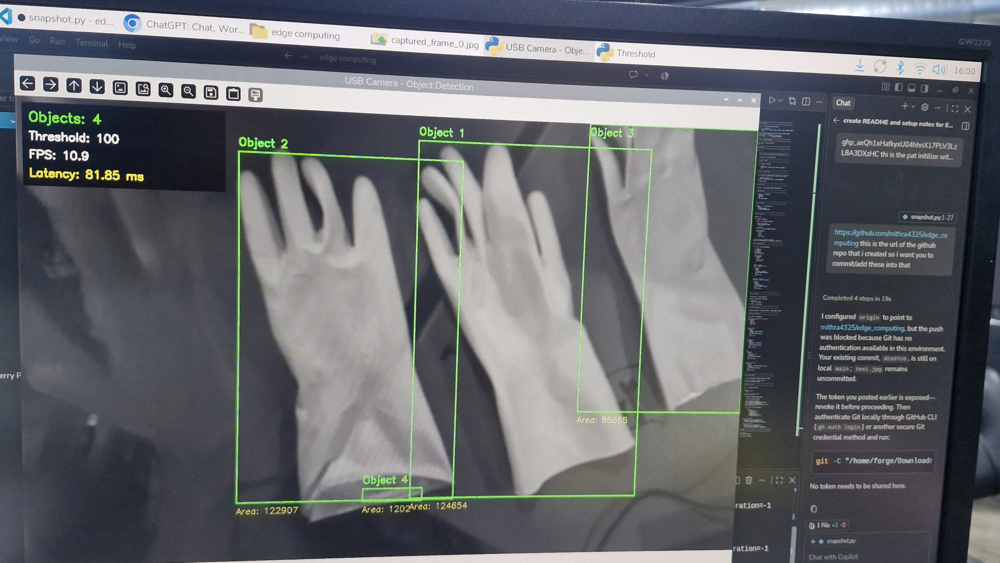
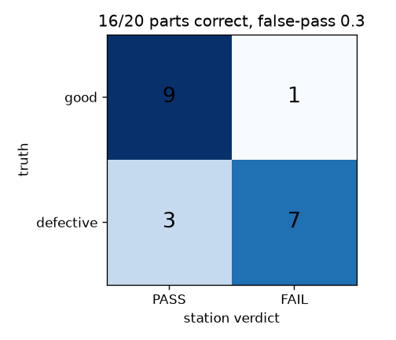
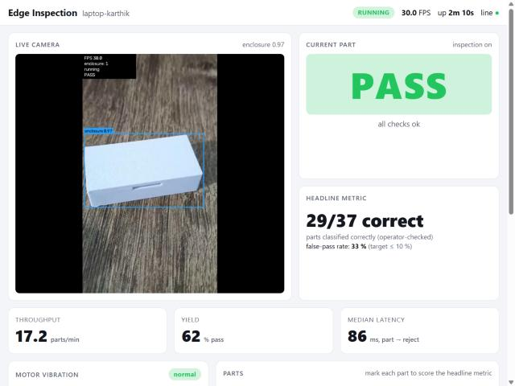
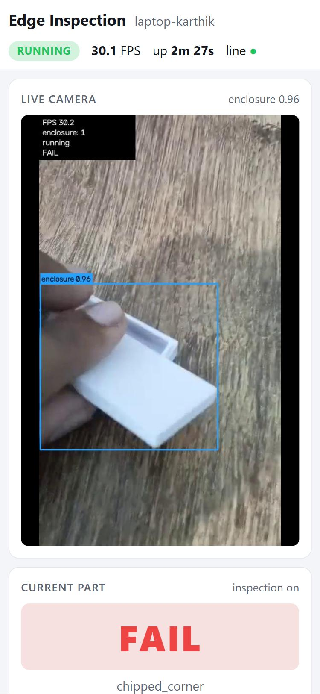
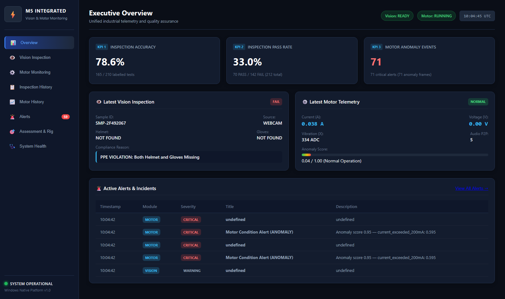
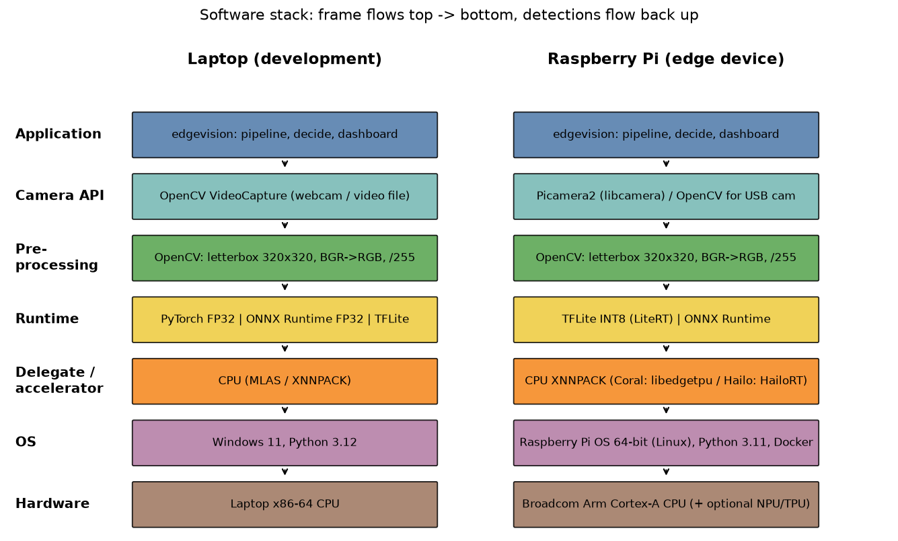

# M5 — Complete System + Dashboard: evidence

One section per task on the marking sheet. Each section shows what the task asks for, what I measured so far, the
files, and a place for the **group run on the Pi** (photos in this folder, videos as Drive/YouTube links).

**Where it ran:** 💻 = measured on my laptop (every json records its host) · 👥 Pi = group run on the shared Pi rig.
Laptop numbers are never presented as Pi numbers. Pi commands: [PI_CHECKLIST § M5](../../docs/PI_CHECKLIST.md#m5--complete-system-on-the-pi).

**Group media rule:** every photo/video from the group session is labelled *"group run on the shared Pi rig — my part:
… — filmed by …"*. My own measured numbers are listed separately from the group media.

### Group system (M5 integrated dashboard)

The group's M5 joins its two earlier systems into one app with one dashboard: the **M3 PPE station** (YOLOv8n,
helmet/gloves → PASS/FAIL, 3 LEDs) and the **M4 SG90 servo monitor** (21-feature anomaly model). My enclosure
inspection and motor monitor are a separate system. All group files are in [group/](group/), one folder per task
(the group numbered them 30–37 for 5.1–5.8).

**Where the group's M5 ran:** 💻👥 on a **Windows 11 laptop** (FastAPI + browser dashboard, laptop webcam). The motor
side **replays the servo data the group recorded on the Pi rig** (1,175 rows); it is not live from the sensors. The
Pi 5 / Arduino rig photos and videos come from M3 and M4. The group's demo notes say this
([Q1](group/37_live_demo_questions/demo_protocol_and_qa.md)).

Group media caption: *group run on the shared Pi rig — my part: filming the group run — filmed by me* (all files in
[group/](group/)).

| Task | Max | Measured so far | Section |
|---|---|---|---|
| Inspection rig | 2 | rig design; stand-in image set with all 4 defect types | [5.1](#51-inspection-rig) |
| Pass/fail station | 4 | 20 parts (10 good, 10 defective): 16/20, false-pass 0.30 (stand-in) | [5.2](#52-passfail-station) |
| Full chain on the device | 4 | 10 min camera → dashboard: 30.0 FPS, 0 errors; 5 breakages fixed (laptop) | [5.3](#53-full-chain-on-the-device) |
| Live dashboard | 4 | live camera + boxes, PASS/FAIL, 3 KPIs, motor alert; desktop + phone | [5.4](#54-live-dashboard) |
| Product readiness | 2 | 7/7 checks: auto-start, offline, log rotation | [5.5](#55-product-readiness) |
| Headline metric | 2 | correct parts / parts checked + false-pass rate, live on the dashboard | [5.6](#56-headline-metric) |
| Documents | 1 | README, datasheet, architecture, stack diagram, demo script — own commits | [5.7](#57-documents) |
| Live demo and questions | 1 | timed demo script: power cycle, normal run, injected fault | [5.8](#58-live-demo-and-questions) |

---

## 5.1 Inspection rig

**Asked:** show a fixed, repeatable camera and light rig and an image set with every defect type.

- Rig design: [docs/RIG.md](../../docs/RIG.md) — camera fixed at 30–45°, plain matte base, end stop so every part sits
  the same way, diffused lamp. The angle shows the side wall, which separates a closed box from a loose lid
  (M1 wrong detection #7).
- 💻 Stand-in image set (real desk frames + **simulated** marks/chips; [manifest](../../data/rig_sim/manifest.json)):
  good parts and all 4 defect types — surface mark, chipped corner, lid missing, lid not seated.
  Code: [scripts/make_sim_rig.py](../../scripts/make_sim_rig.py), real capture [scripts/capture_rig.py](../../scripts/capture_rig.py).

👥 **Group rig** (group's PPE station):
- Pi 5 camera feed: [01_physical_camera_feed.jpeg](group/30_inspection_rig/photos/01_physical_camera_feed.jpeg).
- Rig hardware (already in this repo): Pi 5 [board](../M3/group_pi5_board.jpg), [LED breadboard](../M3/group_led_breadboard.jpg),
  [group member at the bench](../M4/group/01_sensor_data/screenshots/me_working_photo.jpeg).
- PPE test shots: [helmet and gloves 1](group/30_inspection_rig/photos/ppe_helmet_and_gloves_1.jpeg),
  [helmet and gloves 2](group/30_inspection_rig/photos/ppe_helmet_and_gloves_2.jpeg),
  [helmet only](group/30_inspection_rig/photos/ppe_helmet_only.jpeg).
- Image set: labelling in Roboflow ([05_roboflow_defect_annotations.jpeg](group/30_inspection_rig/photos/05_roboflow_defect_annotations.jpeg)),
  and the Kaggle PPE dataset opened on the Pi ([ppe_dataset_on_pi.jpeg](group/30_inspection_rig/photos/ppe_dataset_on_pi.jpeg)).
- Test image set used in 5.2 and 5.6: [10 compliant](group/31_pass_fail_station/test_images/compliant/) (helmet + gloves) and
  [10 non-compliant](group/31_pass_fail_station/test_images/non_compliant/).

## 5.2 Pass/fail station

**Asked:** test 20 parts (10 good, 10 defective) and show the confusion matrix and false-pass rate.

💻 20 stand-in parts ([passfail.json](passfail.json), per part [passfail_results.csv](passfail_results.csv), sheet [passfail_sheet.jpg](passfail_sheet.jpg)):

| | Judged PASS | Judged FAIL |
|---|---|---|
| **Good (10)** | 9 | 1 (false reject) |
| **Defective (10)** | **3 (false pass)** | 7 |

- **16/20 correct, false-pass rate 0.30** — target ≤ 0.10 **not met yet**. Caught: marks 3/3, lid missing 3/3,
  lid not seated 1/2; chipped corners 0/2.
- How it works: the detector finds the part, then simple checks on the crop (dark marks, outline solidity,
  rectangularity) with limits learned from **good parts only** ([inspection_calibration.json](inspection_calibration.json)).
- First attempt before fixes: [passfail_v1_before_fixes.json](passfail_v1_before_fixes.json); defect list: [docs/DEFECTS.md](../../docs/DEFECTS.md).
- Code: [src/edgevision/inspect.py](../../src/edgevision/inspect.py), [scripts/calibrate_inspection.py](../../scripts/calibrate_inspection.py),
  [scripts/passfail_test.py](../../scripts/passfail_test.py).

👥 **Group station** (💻 group laptop, PPE model on the 20 test images above):
- 20 samples (10 compliant, 10 non-compliant): **20/20 correct, 0 false passes**, mean 186 ms per image
  ([pass_fail_20_results.csv](group/31_pass_fail_station/test_results/pass_fail_20_results.csv)). Code: [runner.py](group/31_pass_fail_station/code/runner.py).
- The dashboard's running total, which also counts live webcam inspections, is lower: TP 70, FP 10, FN 35, TN 95 →
  **78.57 % accuracy, false-pass 9.52 %** ([06_assessment_benchmarks.png](group/31_pass_fail_station/screenshots/06_assessment_benchmarks.png)).

## 5.3 Full chain on the device

**Asked:** run camera to dashboard together for 10 minutes and fix what breaks.

💻 10 min, camera (simulated conveyor) → TFLite INT8 → inspection → decision → reject/PLC/run_permit → MQTT TLS →
dashboard, + motor monitor ([full_chain_laptop.json](full_chain_laptop.json), subscriber [full_chain_mqtt_laptop.json](full_chain_mqtt_laptop.json)):

| Measured | Value |
|---|---|
| FPS mean / min | **30.0** / 29.7 |
| Errors / safe-state events | **0** / 0 |
| Parts tracked | 171 of 172 |
| Part → reject latency median / p95 | 84 ms / **90 ms** |
| MQTT messages sent / received | 1857 / 1858, 0 schema failures |

**What broke and how I fixed it:**
1. Chain ran at **2.4 FPS** → the simulator re-blurred the empty-belt image every frame → blur once per part → 30.0 FPS for 10 min.
2. Dashboard showed "connecting…" → screenshot taken before the first WebSocket snapshot → none needed; page reconnects every 2 s.
3. KPI tiles wrapped one per row → camera spanned 3 grid rows → explicit grid placement.
4. Container crash-looped (`config/laptop.yaml` not found) → project root was found from the install path inside Docker → `EDGE_ROOT=/app` + fall back to the working directory.
5. Good parts cut by the image border judged FAIL → part not fully in view → inspector waits until the whole part is in view.

Code: [scripts/station_sim.py](../../scripts/station_sim.py), [src/edgevision/runtime.py](../../src/edgevision/runtime.py).

👥 **Group full chain** (💻 group laptop, 10 Nov 2026 15:36–15:46): webcam → PPE model → decision → backend → database →
dashboard, alongside motor replay → anomaly model → database, for **600.1 s**: 2,417 vision inferences (**4.0 FPS**),
5,843 motor samples (9.7 Hz), **0 errors, 0 recoveries needed**
([10_minute_chain_report.json](group/32_full_chain_device/test_results/10_minute_chain_report.json), log every 30 s
[10_minute_chain_run_log.txt](group/32_full_chain_device/logs/10_minute_chain_run_log.txt), code
[run_10_minute_chain_benchmark.py](group/32_full_chain_device/code/run_10_minute_chain_benchmark.py)).
It ran on Windows, not the Pi, and the motor input was replayed.

## 5.4 Live dashboard

**Asked:** show live detections, PASS/FAIL view, camera view, 3 KPIs and motor alert.

- FastAPI backend (REST + WebSocket + MJPEG) and a static page; loads nothing from the internet, works offline, fits a phone.
- Shows: **live camera with boxes**, big **PASS/FAIL**, headline metric, **3 KPIs** (throughput, yield, median latency),
  **motor card** with score graph that turns red on an anomaly, parts feed with good/defective buttons.
- Code: [src/edgevision/dashboard/server.py](../../src/edgevision/dashboard/server.py), [kpis.py](../../src/edgevision/dashboard/kpis.py),
  [static/](../../src/edgevision/dashboard/static/index.html).

| 💻 Desktop | 💻 Phone |
|---|---|
|  |  |

👥 **Group dashboard** (💻 group laptop; screenshots taken automatically from the running app by
[capture_dashboard_evidence.py](group/33_live_dashboard/code/capture_dashboard_evidence.py)):
- [01_dashboard_overview.png](group/33_live_dashboard/screenshots/01_dashboard_overview.png): 3 KPIs (inspection
  accuracy 78.6 %, pass rate 33.0 %, 71 motor anomaly events), latest PASS/FAIL, latest motor reading, alerts.
- [02_vision_inspection_rig.png](group/33_live_dashboard/screenshots/02_vision_inspection_rig.png) camera view,
  [03_motor_condition_oscilloscope.png](group/33_live_dashboard/screenshots/03_motor_condition_oscilloscope.png) motor graphs,
  [04_live_motor_anomaly_alert.png](group/33_live_dashboard/screenshots/04_live_motor_anomaly_alert.png) motor alert,
  [05_alerts_center.png](group/33_live_dashboard/screenshots/05_alerts_center.png) alert list.
- The earlier M3 dashboard on the Pi: [photo](group/33_live_dashboard/screenshots/m3_pi_dashboard_helmet.jpeg),
  [screen recording](group/33_live_dashboard/videos/m3_pi_dashboard_screen_record.mp4).
- Some alert rows on the overview read "undefined" (a display bug in the group's page).

## 5.5 Product readiness

**Asked:** show auto-start after power-cycle, offline run and logs.

💻 [readiness_laptop.json](readiness_laptop.json) — **7/7**:

| Check | Pass |
|---|---|
| dashboard loads nothing from the internet | ✅ |
| MQTT broker is local | ✅ |
| model + config are files on the device | ✅ |
| containers restart automatically (`restart: unless-stopped`) | ✅ |
| systemd unit restarts the station | ✅ |
| compose stack starts at boot ([edge-compose.service](../../deploy/edge-compose.service)) | ✅ |
| logs rotate (1 MB × 5 files + Docker 5 MB × 3) | ✅ |

Container healthy: [docker_healthy_laptop.txt](docker_healthy_laptop.txt). Code: [scripts/readiness_check.py](../../scripts/readiness_check.py)
(`--pi` adds the power-cycle and offline checks).

👥 **Group app** (💻 group laptop): health page showing backend running, webcam online, motor on recorded data
(1,175 rows), database connected, 0 recovery events ([07_system_health.png](group/34_product_readiness/screenshots/07_system_health.png)).
Start, stop and setup scripts for Windows: [run_m5.bat](group/34_product_readiness/scripts/run_m5.bat),
[stop_m5.bat](group/34_product_readiness/scripts/stop_m5.bat), [setup_windows.bat](group/34_product_readiness/scripts/setup_windows.bat).
Runs offline (local model, local SQLite, no internet). No power-cycle auto-start was recorded.

## 5.6 Headline metric

**Asked:** measure one headline number and show it live.

- Headline: **parts classified correctly out of all parts I checked**, with the **false-pass rate** beside it
  (a defective part passing is the costly error). Target ≥ 18/20 and false-pass ≤ 10 %
  ([docs/DATASHEET.md § 5](../../docs/DATASHEET.md#5-headline-metric)).
- 💻 Measured on the stand-in set: **16/20 correct, false-pass 0.30** ([passfail.json](passfail.json)).
- Live: dashboard tile and `GET /api/kpis` ([kpis.py](../../src/edgevision/dashboard/kpis.py)); the operator marks each
  part good/defective on the dashboard.

👥 **Group headline** (💻 group laptop): correct decisions out of 50 → **50/50 (100 %)**, 0 false passes, mean 191 ms
([headline_metric_50_results.csv](group/35_headline_metric/test_results/headline_metric_50_results.csv); shown live on
the [benchmark page](group/31_pass_fail_station/screenshots/06_assessment_benchmarks.png)). The 50 runs reuse the
**20 test images** from 5.2 (each 2–3 times), so this is 20 different images, not 50. The dashboard's running total
over all inspections is 78.6 % (see [5.2](#52-passfail-station)).

## 5.7 Documents

**Asked:** show my commits to the README, datasheet, architecture diagram or demo video.

| Document | Link |
|---|---|
| README | [README.md](../../README.md) |
| Datasheet | [docs/DATASHEET.md](../../docs/DATASHEET.md) |
| Architecture | [docs/ARCHITECTURE.md](../../docs/ARCHITECTURE.md) |
| Software stack diagram | [docs/stack.png](../../docs/stack.png) |
| Demo script + video shot list | [docs/DEMO.md](../../docs/DEMO.md) |
| Viva notes | [docs/VIVA_NOTES.md](../../docs/VIVA_NOTES.md) |

All written and committed by me: [commit history](https://github.com/mkarthikaravind1/Edge_AI_Project/commits/main).

👥 **Group documents** ([group/36_documents/documentation/](group/36_documents/documentation/)):
[system architecture](group/36_documents/documentation/system_architecture.md),
[datasheet](group/36_documents/documentation/datasheet.md),
[known limitations](group/36_documents/documentation/known_limitations.md),
[dashboard guide](group/36_documents/documentation/dashboard_guide.md),
[inspection workflow](group/36_documents/documentation/inspection_workflow.md),
[motor monitoring workflow](group/36_documents/documentation/motor_monitoring_workflow.md),
[testing methodology](group/36_documents/documentation/testing_methodology.md),
[reliability report](group/36_documents/documentation/reliability_report.md),
[Windows setup](group/36_documents/documentation/windows_setup.md),
[M3 source audit](group/36_documents/documentation/m3_source_audit.md),
[M4 source audit](group/36_documents/documentation/m4_source_audit.md),
[media catalogue](group/36_documents/documentation/media_catalog.md). Some links inside these files point to the
group's own repo layout.

## 5.8 Live demo and questions

**Asked:** run one normal run and one injected fault, and answer the coach's questions.

- Timed script (~6 min): [docs/DEMO.md](../../docs/DEMO.md) — power cycle hands-off → dashboard back → **normal run**
  (3 good parts: PASS) → **injected fault** (marked and lid-missing parts: FAIL, reject pulses, PLC counts, MQTT message)
  → motor fault on the IMU → headline metric.
- Explanations for every task in simple words: [docs/VIVA_NOTES.md](../../docs/VIVA_NOTES.md).

👥 **Group demo plan and questions:** [demo_protocol_and_qa.md](group/37_live_demo_questions/demo_protocol_and_qa.md):
a normal run (PPE PASS/FAIL, 3 LEDs, motor graphs) and an injected motor fault (current surge > 200 mA → score 0.95 →
red ANOMALY → back to normal), plus 5 prepared answers (why Windows, YOLO classes, LED logic, anomaly model,
live vs replayed data). Fault video from the rig: [M4 anomaly video](../M4/group/02_anomaly_model/videos/video_showing_anomaly.mp4).

---
More: [VIVA_NOTES § M5](../../docs/VIVA_NOTES.md#m5-complete-system--dashboard) · all numbers: [RESULTS § M5](../../docs/RESULTS.md#m5)
