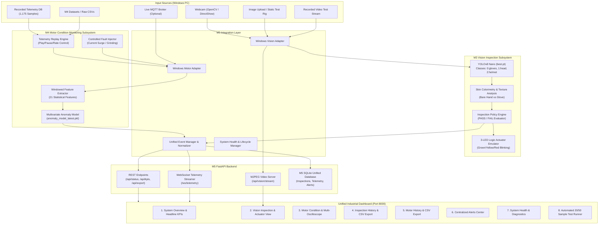

# M5 System Architecture: Integrated Vision Inspection & Motor Monitoring

## 1. High-Level Architectural Diagram

---

## 2. Decoupled Resilience Model
- **Independent Modules**: Vision and Motor monitoring execute in separate, isolated worker threads. A failure or disconnection in camera acquisition has zero impact on motor telemetry processing, and vice versa.
- **Fail-Safe Fallbacks**: If the webcam is disconnected, the vision pipeline safely degrades to static test image or recorded video mode without throwing unhandled exceptions.
- **Unified Event Pipeline**: All signals flow through `event_manager`, guaranteeing synchronized UTC ISO-8601 timestamps, explicit source labels, and persistent audit logging.

